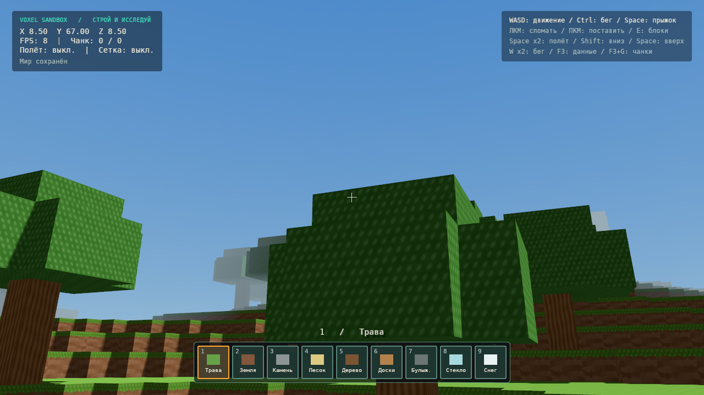
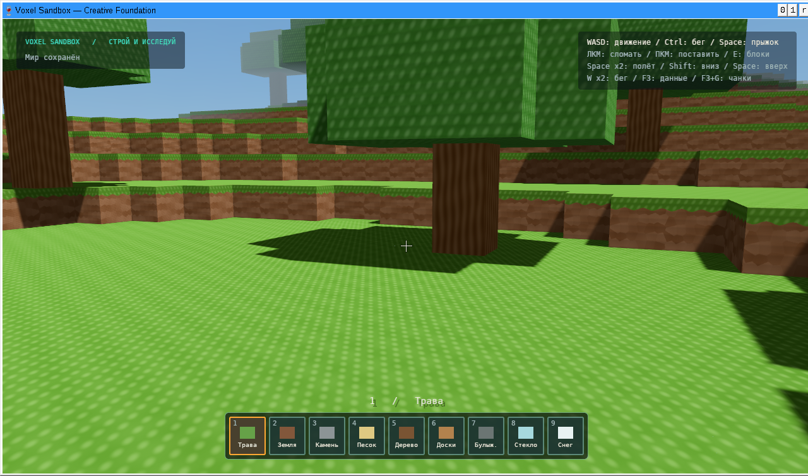
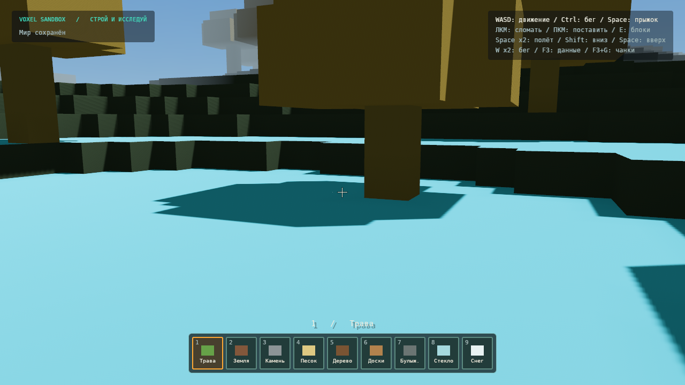

# Исторический отчёт о рендерере

После этого обновления процедурная резервная графика удалена. Актуальное поведение и обязательный путь `assets/atlas_128x128.png`: [HUD, иконки и звуки](HUD_ICONS_AUDIO.md). Скриншоты ниже относятся к предыдущей сборке.

# Массив текстур 128×128 — 8 ноября 2026

Рендерер подготовлен для пользовательского рисованного атласа. **Точное совпадение с референсом пока не проверено:** файла `assets/textures/atlas_128x128.png` нет в полученных вложениях и репозитории. Временные процедурные поверхности на скриншотах ниже — не исходный атлас пользователя.

## Подключение

PNG должен иметь размер **768×384**, 6 столбцов × 3 строки по 128 пикселей. Индексы идут слева направо, сверху вниз. Изображение не переворачивается и не растягивается загрузчиком.

Поместите PNG в `assets/textures/atlas_128x128.png` рядом с EXE либо в корень репозитория по этому пути. После замены перезапустите игру. При следующей сборке этот файл также попадёт внутрь EXE. Для отдельного расположения задайте `VOXEL_ATLAS`; путь рядом с EXE имеет приоритет над рабочей папкой. Неверный PNG/размер отклоняется с ошибкой в журнале и включением резервной графики.

`assets/blocks.ron` задаёт top/side/bottom для каждого из 16 стабильных ID блоков. Этот RON встроен, но файл рядом с EXE позволяет переопределить таблицу после перезапуска. Проверяются число записей и диапазон слоёв 0…17. Стабильные ID, генератор и сохранения не изменены.

| Слой | Поверхность |
|---|---|
| 0 / 1 / 2 | Трава сверху / трава сбоку / земля |
| 3 / 4 / 5 | Камень / тёмный камень / песок |
| 6 / 7 / 8 | Булыжник / кора / торец бревна |
| 9 / 10 / 11 | Листва / доски / мшистый булыжник |
| 12 / 13 / 14 | Стекло / вода / снег-лёд |
| 15 / 16 / 17 | Песчаник сбоку / песчаник сверху / резерв |

В существующем реестре нет отдельного мшистого блока; слой 11 доступен для назначения через RON. Гравий использует слой 6, поскольку отдельной текстуры гравия в указанной сетке нет.

## Рендеринг

- PNG декодируется в RGBA sRGB и разрезается на **один D2Array из 18 слоёв**. Никакие UV не адресуют соседние тайлы исходной картинки.
- У каждого слоя отдельная цепочка из **8 mip-уровней**, 128→1. Цвет усредняется в линейном пространстве с учётом premultiplied alpha, поэтому прозрачные края не дают чёрного ореола. Данные загружаются в явном `LayerMajor` порядке.
- Mag/min/mipmap — **Linear**, анизотропия **8**, Repeat по U/V. В шейдере нет `fract(UV)`: производные сохраняются и на границах повторения. Padding для texture array не требуется.
- Greedy meshing оставляет UV в блоковых единицах: прямоугольник 16×16 повторяет тайл 16 раз в обе стороны. Бок травы ориентирован зелёной частью вверх; верх и низ выбираются независимо через RON.
- Вершинный AO использует два боковых и один диагональный сосед с внешней стороны грани, яркость 0,76…1. Грани с неоднородным AO остаются отдельными; одинаковые равномерные участки объединяются. Диагональ треугольника выбирается по AO. На границах секций используется один общий алгоритм и снимок соседей.
- Правка углового блока обновляет до 8 секций; загрузка/выгрузка чанка обновляет также диагонали. Старые фоновые результаты по-прежнему отбрасываются при новой правке.
- Материал — расширение стандартного forward PBR Bevy. Высокая шероховатость и слабый блик сохраняют читаемость рисованной поверхности. Стекло/вода используют Blend, листва — Mask; авторский alpha сохраняется, для полностью непрозрачных RGB-тайлов стекла/воды задаётся резервная прозрачность. Стекло/вода не отбрасывают сплошную тень.
- Направленный источник: до 10 100 люкс, тёплый оттенок на низком солнце, рассеянный свет. Тени: Gaussian PCF, 2 перекрывающихся каскада, дальность 96 блоков. Шейдер теней листвы читает alpha из того же слоя массива.
- Небо — непрерывный градиентный cubemap с ярким горизонтом и более синим зенитом. Цикл дня/ночи сохранён. Туман начинается с 55% видимой дальности и скрывает границу загрузки; его цвет и небо согласованы в линейном пространстве с экспозицией камеры.

Для будущего deferred-рендерера потребуется отдельный deferred fragment shader; текущий клиент использует forward. Сортировка прозрачности пока выполняется по мешам секций и может давать артефакты пересечения воды/стекла. Бесшовность рисунка внутри исходного тайла зависит от предоставленного PNG; массив устраняет протекание **соседних тайлов**, но не исправляет нарисованный шов.

## Проверки

`cargo test --workspace --locked`: **73 passed**, 0 failed/ignored. Форматирование, `cargo clippy --workspace --all-targets --locked -- -D warnings`, native build и Windows GNU x64 release build проходят.

Через Wine выполнены Windows-клиентские тесты (**10**), тесты рендерера (**21**) и round-trip сохранений (**1**): **32 passed**, 0 failed/ignored. Тесты покрывают PNG/размеры/порядок строк, RON, фильтрацию, изоляцию мипов, alpha стекла, greedy UV, ориентацию граней и совпадение AO на границе секций.

Linux/Xvfb и упакованный Windows EXE/Wine/Vulkan: создание мира с seed 3, поверхности массива, листва с тенями, градиент неба, F3 и сохранение. После исправления варианта alpha-mask shadow shader журнал не содержит ошибок шейдеров/wgpu. Программный llvmpipe; настоящая Windows и аппаратный GPU не проверялись, целевые FPS не измерялись.

Отдельный цветовой PNG-стенд загружен через `VOXEL_ATLAS`: цвет травы меняется на голубой, а остальные поверхности — на цвета своих слоёв. Это проверка пути загрузки, а не игровые текстуры.

