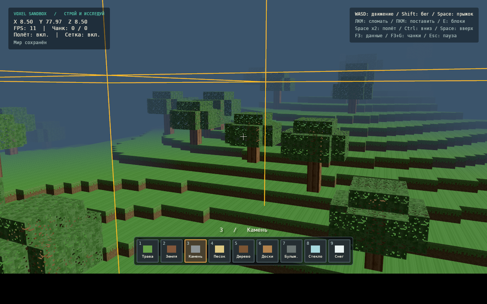
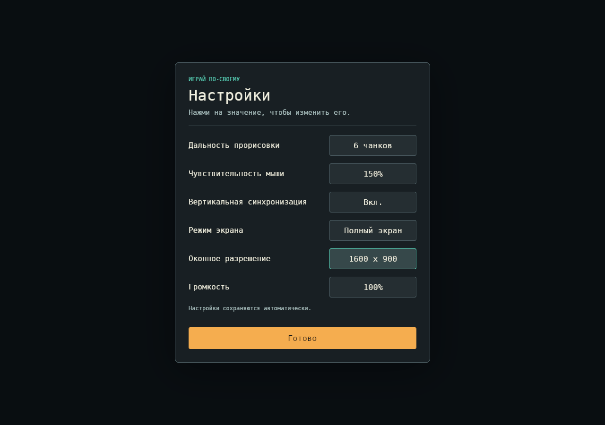

# Исправления и управление — 8 ноября 2026

Это отчёт предыдущего патча. Актуальная раскладка и оформление: [VISUAL_REFRESH.md](VISUAL_REFRESH.md).

## Исправлено

- Изменение громкости, мыши, дальности или оконного разрешения не задаёт заново размер полноэкранной поверхности. В режиме без рамки разрешение определяется монитором; выбранное оконное разрешение применяется при выходе из fullscreen.
- Трава: зелёная верхняя грань, земляная нижняя, зелёный край вверху боковых граней. Горизонтальные грани больше не повторяют полосы боковой текстуры.

## Добавлено

- Двойное нажатие Space (интервал до0,3с) переключает полёт. Space поднимает, Ctrl опускает. Полёт сохраняет столкновения с блоками и защиту от незагруженных чанков.
- Левый/правый Shift ускоряют ходьбу и полёт.
- Колёсико циклически выбирает девять слотов; дробные движения тачпада накапливаются. Инвентарь продолжает прокручиваться отдельно.
- Русский интерфейс/названия/подсказки. В EXE встроен DejaVu Sans Mono с кириллицей; лицензия находится рядом с исходным шрифтом и в ZIP.
- F3 переключает координаты, средний FPS за полсекунды, координаты чанка и состояние полёта/сетки. Переключение при отпускании позволяет отличать F3+G.
- F3+G показывает/скрывает реальные границы ближайших3×3чанков и16-блочных секций по всей высоте мира, включая отрицательные координаты. Сочетание не меняет видимость панели F3.

## Проверено

- `cargo test --workspace --locked`: 61 тест прошёл, 0 упавших/пропущенных.
- `cargo clippy --workspace --all-targets --locked -- -D warnings`, форматирование, Linux build и Windows release build проходят.
- Windows-конфигурация клиентских тестов выполнена через Wine: 8 passed,0failed; в том числе повторная запись настроек с fullscreen, обработка клавиш/колёсика и защитная коллизия.
- Linux/Xvfb: русский текст, трава, переключение слотов, подъём в полёте сY67 доY77,97, FPS и сетка чанков. F3 показал фактические ~11FPS программного рендера — аппаратная скорость не измерена.
- Windows EXE/Wine/Vulkan: fullscreen1280×900 сохранился после изменения громкости80→100%, чувствительности100→150%, дальности4→6 и оконного разрешения1280×720→1600×900. Настройки записаны на диск; fullscreen осталсяtrue.

На настоящей Windows-машине эта сборка ещё не проверялась. Указанные результаты Wine относятся к тестовой среде Linux с программным Vulkan, не к производительности целевой видеокарты.
