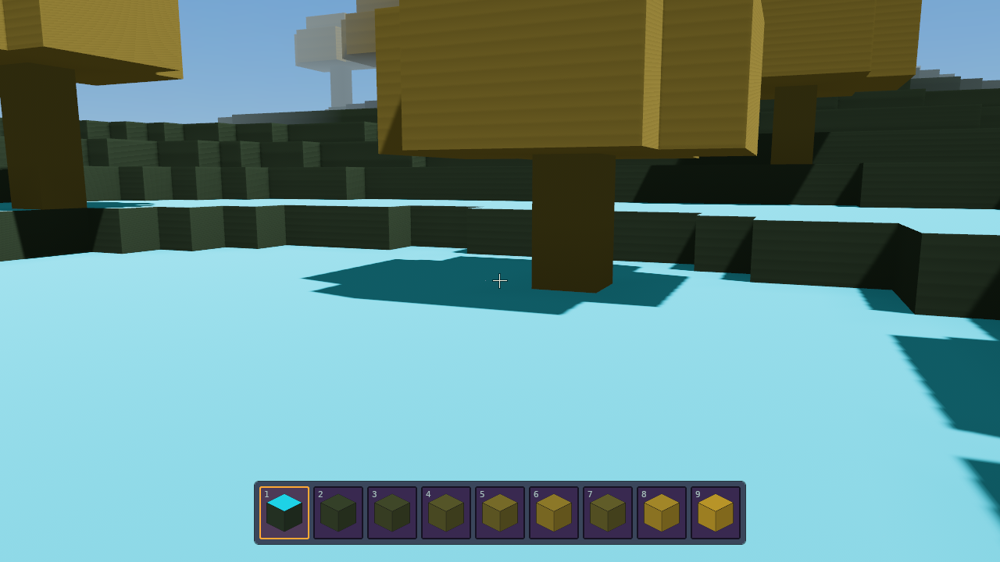
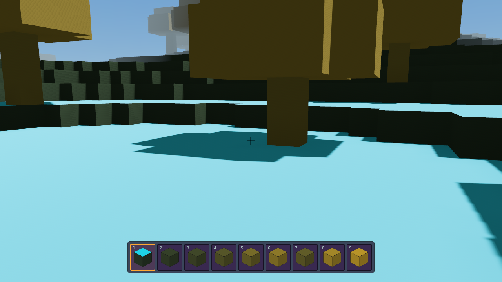
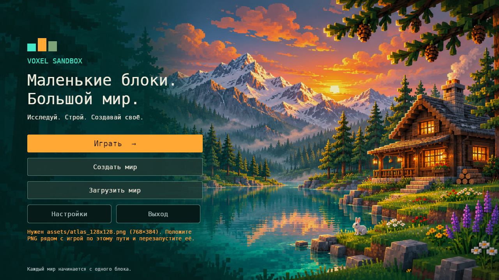
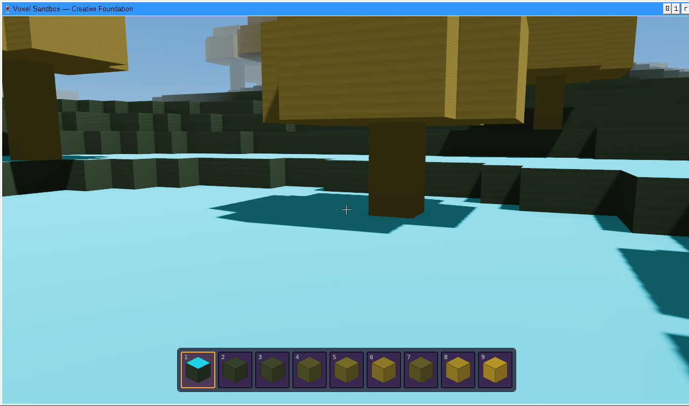

**Исторический отчёт до получения архива.** Текстуры теперь получены и встроены без изменений; актуальная сборка запускается без внешнего атласа. См. [исходные текстуры и значок](ORIGINAL_TEXTURES.md).

# HUD, unchanged atlas, cube icons and block sounds — 9 November 2026

The default playing HUD contains only the crosshair and nine-slot hotbar. The title/save notification and control-help corner panels were removed. F3 reveals coordinates/FPS/flight/chunk information and hides the entire debug panel again; diagnostics also reset to hidden when opening another world.

The hotbar has a translucent dark-purple panel, nine dark slots and a bright selected border. Its cached icons project the atlas's top and side tiles onto an isometric cube. Left/right RGB multipliers are 0.85/0.70, with a thin dark outline. The icons are baked once on atlas load and reused by handle, including after inventory selection, wheel input, or keys1–9. No per-frame icon rendering occurs. See [icon implementation](HOTBAR_ICONS.md).

The only production source for block artwork is the unchanged `assets/atlas_128x128.png` (768×384,6×3,128px tiles). The previous procedural texture generator was deleted. PNG source bytes are copied/embedded without re-encoding; image decoding, per-layer GPU mipmaps and icon rasterization use those pixels. An absent or invalid PNG shows an error in the menu and prevents creating/loading a world with substitute textures. Existing save files remain untouched. `VOXEL_ATLAS` and the legacy `assets/textures/atlas_128x128.png` path are supported.

**Pending input:** the exact original PNG is currently only visible inline in chat. Its bytes do not exist in the repository or attachment filesystem. A ZIP upload containing that PNG is needed to finish pixel matching and a ready-to-play package. No replacement atlas was generated.

Every non-air block has break/step/place sounds with three saved WAV variants. Files are original offline Foley made from filtered noise and material resonances. Playback picks a variant and pitch0.95…1.05; emitters live at the block center and attenuate with listener distance. The player camera supplies the spatial listener. Successful block edits produce break/place events; rejected edits remain silent. Walking steps require actual horizontal movement while grounded, at least0.4s apart; sprinting uses0.25s. Flight, jumping, pausing and pushing against a wall reset the cadence. Missing/corrupt overrides warn and fall back to valid embedded clips. Emitters have finite lifetime even without an audio device. See [audio details](BLOCK_AUDIO.md).

Validation: **87 native tests passed** (41 core,26 renderer,1 save scenario,19 client); formatting, strict workspace Clippy and native/Windows GNU x64 release builds pass. Windows binaries executed through Wine: **46 passed** (19 client,26 renderer,1 save scenario). Independent focused review found no critical/important issues.

Linux/Xvfb and the Windows EXE through Wine/Vulkan with a fixture-only colored atlas verified the clean HUD, nine cube icons, F3 visibility toggle and key9/wheel selection. Actual gameplay logs show grass step events separated by0.439/0.448s, then successful Break and Place events at the same block center with pitches within0.95…1.05. Sprinting produces a shorter interval. Missing-atlas startup displays an error and rejects world creation without creating a save. All135 WAVs decode, are distinct and non-silent, with mono16-bit22,050Hz audio, duration0.206…0.573s and moderate peaks0.250…0.399. Damaged/missing overrides and emitters without an audio device have regression coverage.

Fixture-only colored atlases exercise loading, icon geometry and HUD behavior; they are never packaged as game artwork. The exact reference and audible playback on real Windows/audio hardware remain unverified until the required input/device is available.

