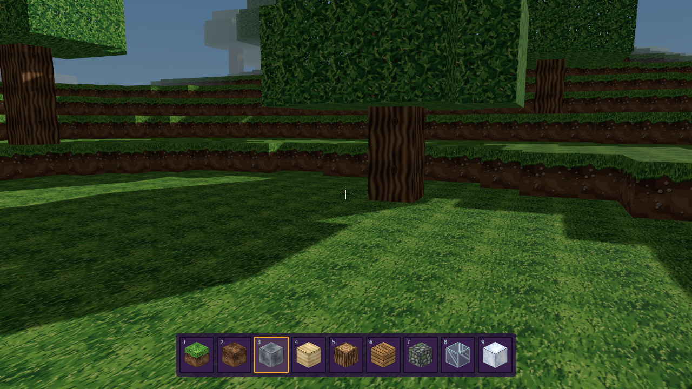
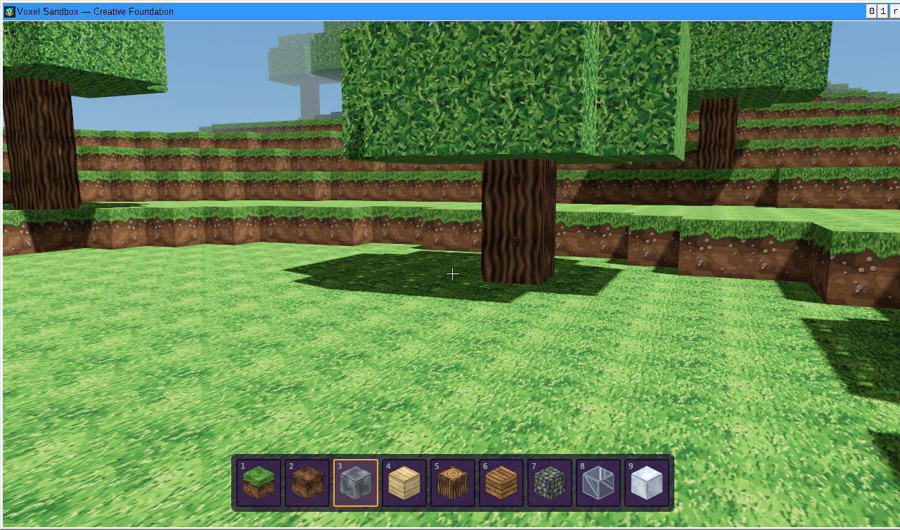

# Исходные текстуры и значок приложения — 9 ноября 2026

Получен `textures_cut.zip`:17 отдельных PNG128×128. Все файлы сохранены побайтно без изменений в `assets/textures/`. Их SHA-256 и хеш исходного ZIP записаны в `assets/textures/source-hashes.json`.

Вместо пересохранения общего PNG загрузчик копирует декодированные RGBA-пиксели в память:17 слоёв и пустой резервный18-й. Базовые GPU-слои и иконки хотбара используют те же пиксели. Генератора подменных текстур нет. Гравий использует присланный `gravel.png`; мшистый булыжник — `cobblestone.png`; верх/бок/низ травы и торцы брёвен сохраняют отдельные назначения в RON.

Все17 PNG встроены в EXE исходными байтами. Игра запускается без внешнего атласа и папки ресурсов. Копии PNG в Windows ZIP позволяют менять ресурсы; они также совпадают с оригинальным архивом. Полный PNG768×384 остаётся дополнительным способом переопределения через `assets/atlas_128x128.png` или `VOXEL_ATLAS`.

Значок приложения подготовлен по присланному в чате логотипу инструментом редактирования изображений. Исходного файла логотипа в ZIP нет, поэтому это подготовленная версия референса, а не побайтная копия файла иконки. `app.ico` содержит размеры16…256px и встроен в ресурсы Windows EXE; PNG128px применяется к окну и панели задач. Для Bevy0.20 используется `WINIT_WINDOWS` на главном потоке; регрессионный тест проверяет запуск системы до появления окна. Сборка GNU использует MinGW windres с выбранным cross-compiler; MSVC — Windows SDK rc.exe.

Тени, линейная фильтрация, восемь мип-уровней и анизотропия×8 сохранены. Чистый HUD, F3, кубический хотбар, управление и135 звуков блоков продолжают работать.

## Проверка

`cargo test --workspace --locked`: **92 passed**,0 failed/ignored (41 core,30 renderer,1 save scenario,20 client). Форматирование, strict Clippy и сборки Linux/Windows GNU x64 проходят. Windows-тесты через Wine: **51 passed** (20 client,30 renderer,1 save scenario).

Linux/Xvfb: создание мира seed3, исходные текстуры/кубические иконки, чистый HUD и новый значок окна128×128. Windows EXE через Wine/Vulkan: запуск из папки, содержащей только EXE, и создание мира с исходными текстурами без внешних PNG/звуков. В PE проверены7 ресурсов ICON и GROUP_ICON; SDK-компилятор MSVC ищется через find-msvc-tools, включая Windows SDK вне PATH. Запуск на настоящей Windows, MSVC-сборка и аппаратная производительность пока не проверены. Тесты сравнивают каждый исходный RGBA-пиксель с данными атласа в памяти и базового GPU-слоя, проверяют изоляцию мипов и назначения граней. Контрольные суммы дополнительно проверяют сохранность самих PNG-файлов и файлов в скачанном с GitHub Windows ZIP.

