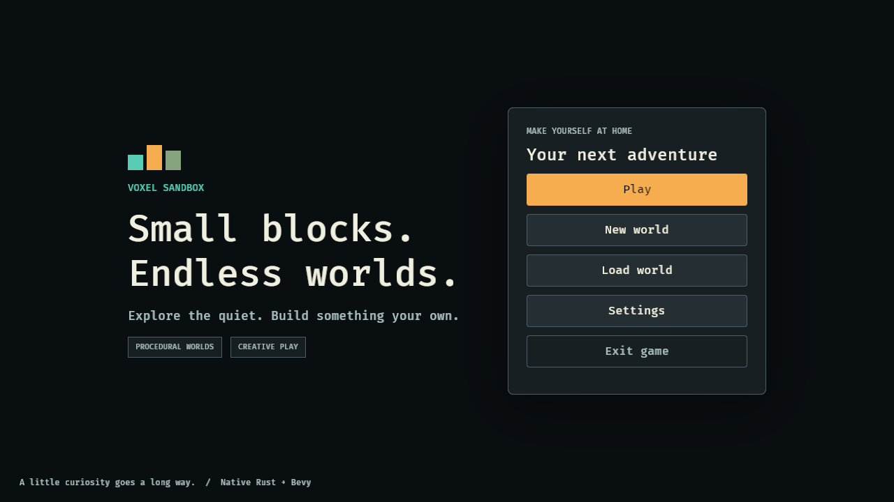
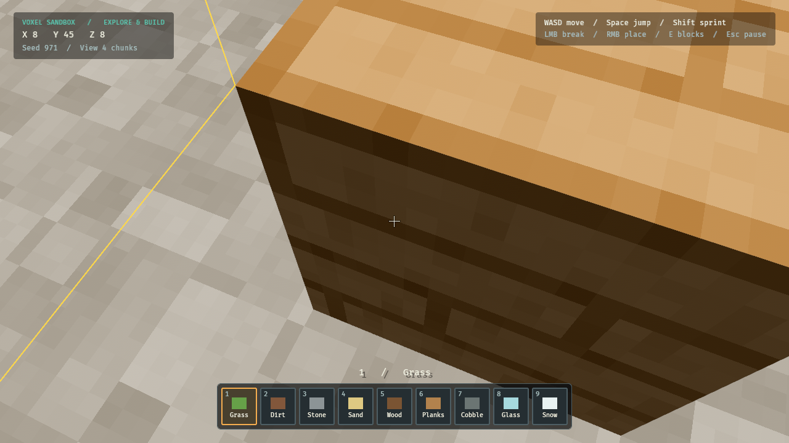
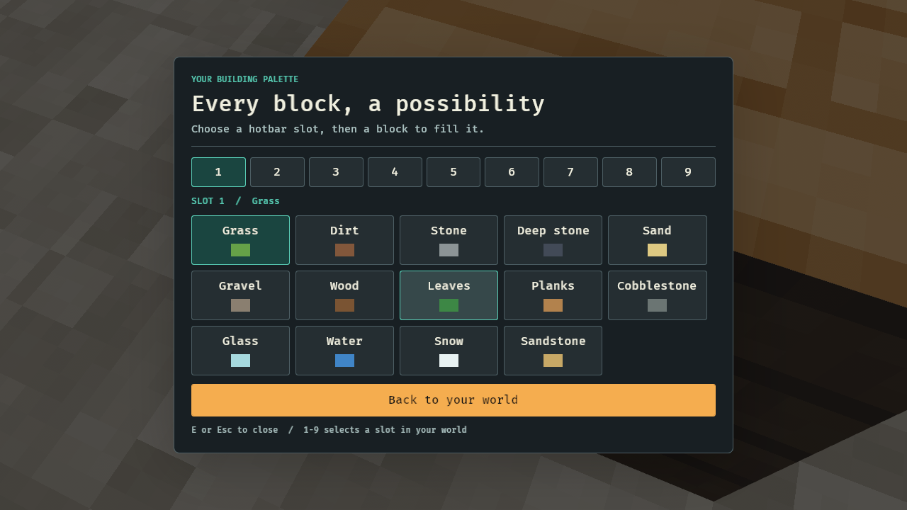
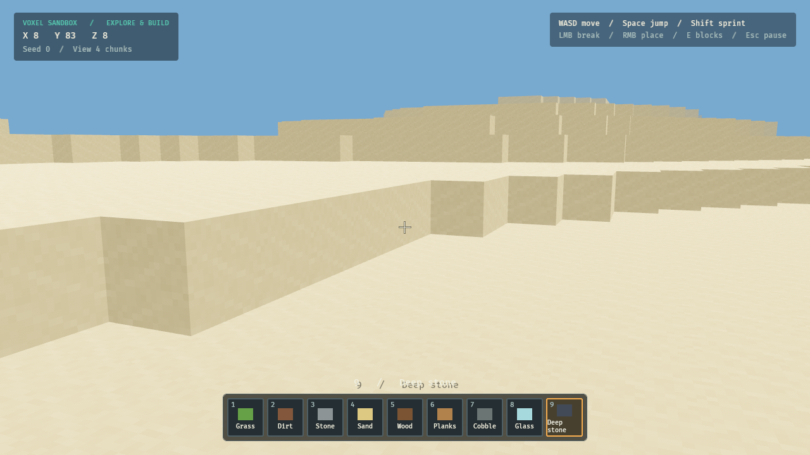

# Проверка творческого фундамента

Дата: 8 ноября 2026. Среда: Debian 13 x64, 5 доступных CPU, ~33 GiB RAM; Rust 1.99.1, Bevy 0.20.1. Графика: Xvfb 1280×720 и llvmpipe Vulkan (программный рендер).

## Автоматические проверки

Запущены из корня репозитория с `Cargo.lock`:

- `cargo fmt --all -- --check` — прошёл.
- `cargo check --workspace --locked` — прошёл.
- `cargo clippy --workspace --all-targets --locked -- -D warnings` — прошёл.
- `cargo test --workspace --locked` — 54 теста прошли: 41 game_core, 10 game_render, один сквозной сценарий, два клиентских теста безопасного появления и данных соседнего чанка. Нет пропущенных или ожидаемо падающих тестов. Doc-tests: 0 тестов.
- `cargo build -p voxel-client --locked` — прошёл, Linux debug-клиент собран.

Регрессии, найденные при независимом ревью и исправленные:

- Контакт с блоком после округления float на координатах ±256…±65536 не мешает падению и скольжению вдоль стены.
- Вставание проверяет всю ширину/высоту стоящего игрока; загрузка начинается с присевшего коллайдера и расширяет его после появления данных мира.
- Несовместимая будущая версия сохранения не заменяется более старой резервной копией.
- Ошибка автосохранения не повторяет запись каждый кадр; новая попытка через 30 секунд.
- Вода доступна для выбора DDA и удаления в творческом режиме, оставаясь проходимой.

## Реальное окно

В отдельном Xvfb-дисплее выполнены действия мышью и клавиатурой:

1. Открыто главное меню; после исправления высоты панелей все кнопки видны при 1280×720.
2. Открыта форма, введён seed `971`, создан мир.
3. Сгенерирован и отображён ландшафт, игрок приземлился на поверхность.
4. Выбраны доски (слот 6), мышью установлен блок `[8,45,7]`.
5. Нажат F5, в проверенном JSON сохранения записан ID9 в этой позиции.
6. Через паузу выполнен возврат в меню и выход; процесс завершился.
7. Клиент запущен новым процессом. Через Load world открыт сохранённый мир; установленный блок вновь отображён, положение и обзор восстановлены.
8. Открыт каталог, выбран слот9 и Deep stone; HUD отразил выбор.
9. Создан дополнительный мир с seed0; безопасная точка появления находится на сухой поверхности пустыни.
10. Удержание A переместило игрока с `[8.5,45,8.5]` на `[-7.7,45,16.7]` через отрицательную границу чанка. Новое положение записано через F5.

Сквозной тест дополнительно проверяет строительство и разрушение на границе отрицательных чанков, сохранение/новый экземпляр/загрузку и ремешинг.






Предупреждения о программном GPU и отсутствующем звуковом устройстве ожидаемы в этой среде. Звук на реальном устройстве, аппаратная производительность, все варианты настроек/разрешений и Windows-сборка не проверены. Скриншоты подтверждают текущий рабочий этап, не художественную готовность текстур или весь критерий v1.0.

## Воспроизведение headless-запуска в подготовленной среде

```bash
source /workspace/.voxel-env/activate.sh
cd /workspace/voxel-sandbox-rust
mkdir -p /workspace/.voxel-env/runtime /workspace/.voxel-env/cache
chmod 700 /workspace/.voxel-env/runtime
export XDG_RUNTIME_DIR=/workspace/.voxel-env/runtime
export XDG_CACHE_HOME=/workspace/.voxel-env/cache
export VK_DRIVER_FILES=/workspace/.voxel-env/sysroot/usr/share/vulkan/icd.d/lvp_icd.json
export DISPLAY=:99
Xvfb :99 -screen 0 1280x720x24 -nolisten tcp > /tmp/voxel-xvfb.log 2>&1 &
# Для отдельного тестового мира, не затрагивающего пользовательские сохранения:
export VOXEL_SAVE_DIR=/workspace/.voxel-env/qa-saves
RUST_LOG=info cargo run --locked -p voxel-client
```

Проверять не только PID/порт, но и окно, лог и действия создания/загрузки мира. Останавливать только свои процессы Xvfb/игры. Проверочные сохранения находятся вне checkout; пользовательские сохранения не изменялись.

Доступ к чтению репозитория Git работает. Чтение GitHub Issues через установленный `gh` вернуло Forbidden; Issues не были просмотрены, изменения на GitHub не отправлялись.
