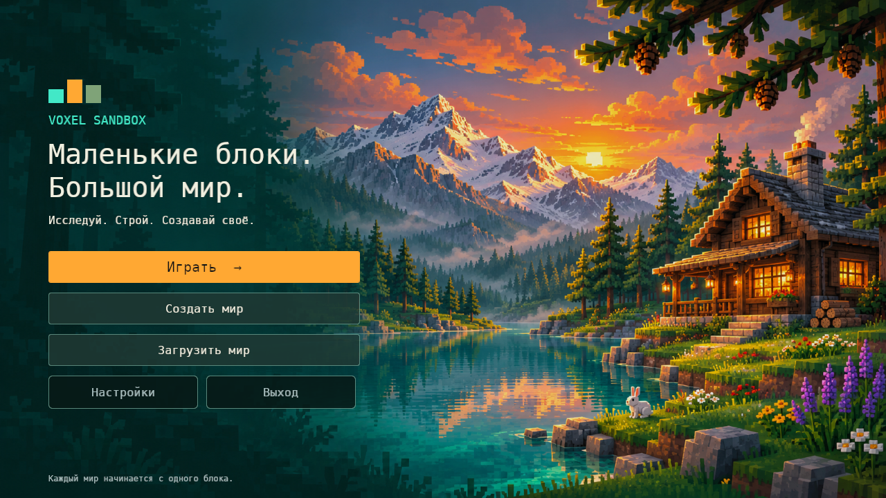
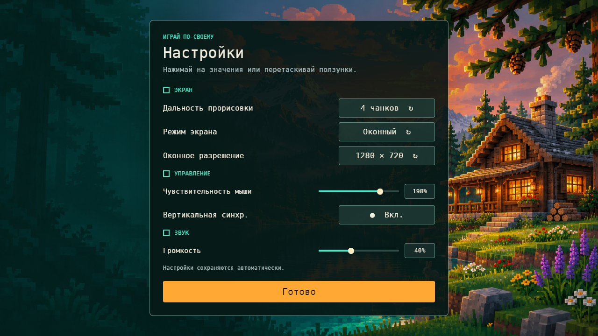
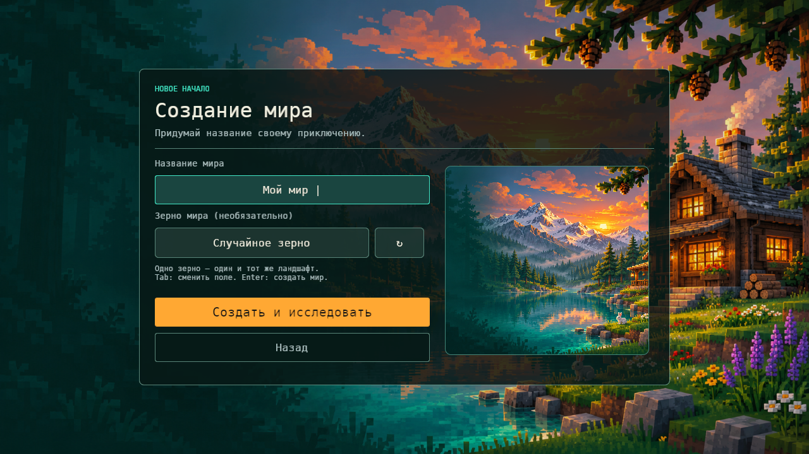
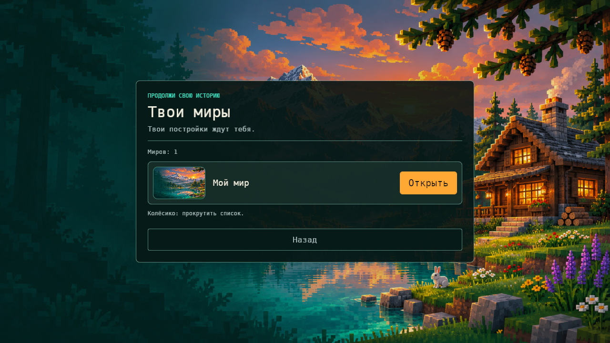
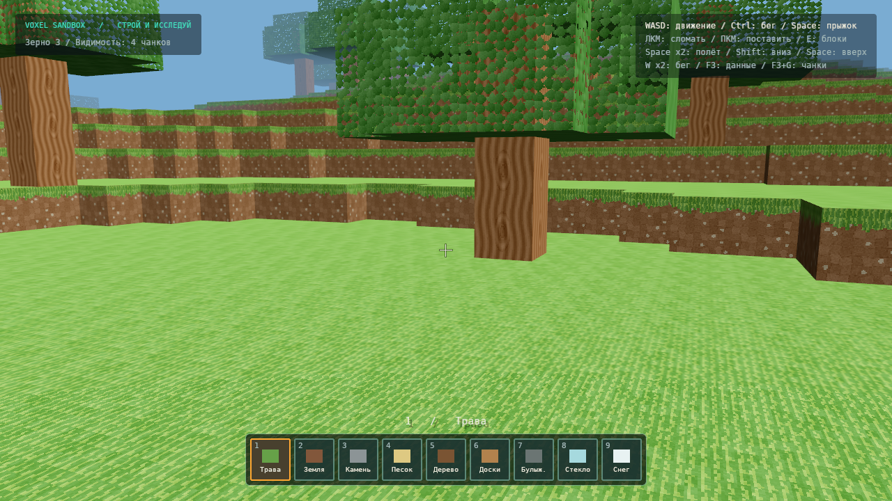
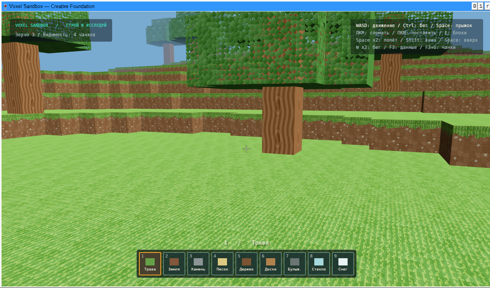

# Новые текстуры, меню и раскладка

Обновление по новым референсам пользователя, 8 ноября2026.

Меню использует встроенную оригинальную иллюстрацию озера/гор/домика, тёмные полупрозрачные панели, бирюзовые акценты и янтарные кнопки. Перестроены главное меню, создание мира (форма и иллюстрация), список сохранений (карточки), настройки (разделы и настоящие ползунки). Кнопка ↻ генерирует новое зерно. Обложки — декоративная иллюстрация, не снимок мира и не обещание такого ландшафта при выбранном seed. В паузе за панелью остаётся текущий игровой мир.

Материалы полностью переработаны:64×64, клеточная структура камней и гравия, почва с камешками, отдельная зелёная поверхность травы, кора/торцы с кольцами, доски, листва, песок, песчаник, стекло, снег и вода. Верх/низ травы и торцы брёвен имеют отдельные render-слоты16–18: сохранённые ID блоков0–15 не менялись. UV повторяются в двух измерениях, не сжимаются в полоску. У каждой текстуры7 mip-уровней: вдали применяется фильтрация, вблизи сохраняется пиксельное увеличение. Вода остаётся статической.

## Управление

- Space дважды: переключить полёт.
- В полёте Space поднимает, левый/правый Shift опускают.
- Левый/правый Ctrl ускоряют ходьбу и полёт.
- Два нажатия W с интервалом до0,3с включают ускорение до отпускания W. Удержание без второго нажатия не включает его; автоповтор клавиатуры не считается вторым нажатием.
- Shift на земле — приседание. Колёсико,1–9,E,F3,F3+G и F5 сохранены.

## Проверки

-64 теста в Linux:41core,12render,1сквозной,10client;0failed/ignored.
- Клиентские Windows-тесты через Wine:10passed,0failed. Clippy -D warnings, форматирование и Windows release build прошли.
- Реальное окно Linux: меню/формы/карточки/64px-материалы, ползунки с сохранением198%чувствительности и40%громкости.
- Контроль ввода на seed3: после подъёма Y82,67, Shift снизил Yдо77,44; Space поднял до86,40. Обычный W дал7,68блока перемещения, двойной W —13,97 за тот же интервал удержания. Ctrl+Space поднял игрока доY97,69. Эти числа подтверждают ввод, не являются тестом производительности целевого ПК.
- Windows EXE через Wine/Vulkan открыл новое графическое меню и создал/отрисовал мир с новыми материалами. Настоящая Windows и аппаратная видеокарта пока не проверялись.

